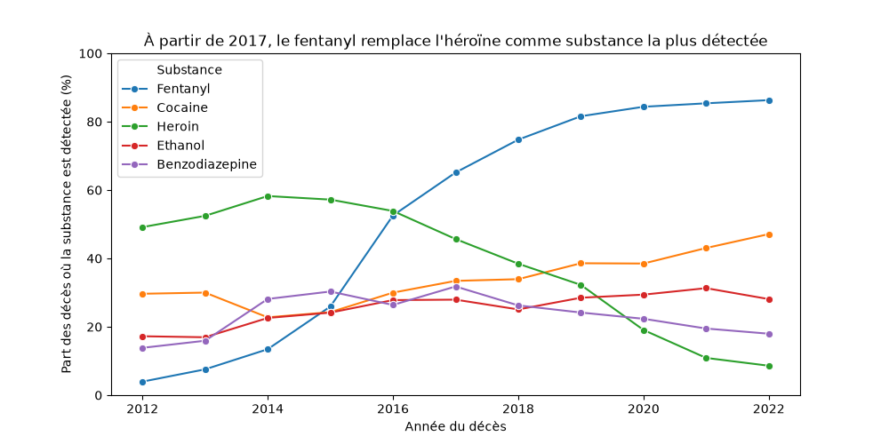
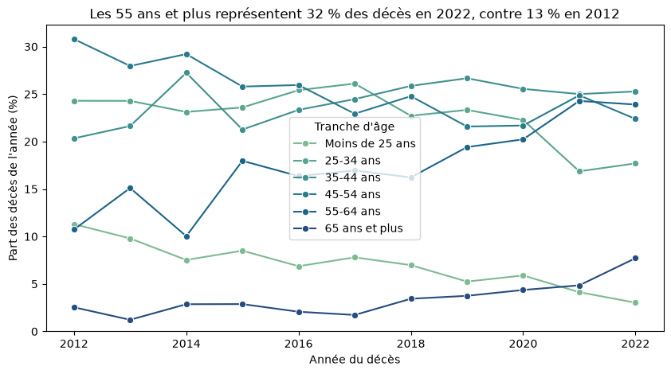
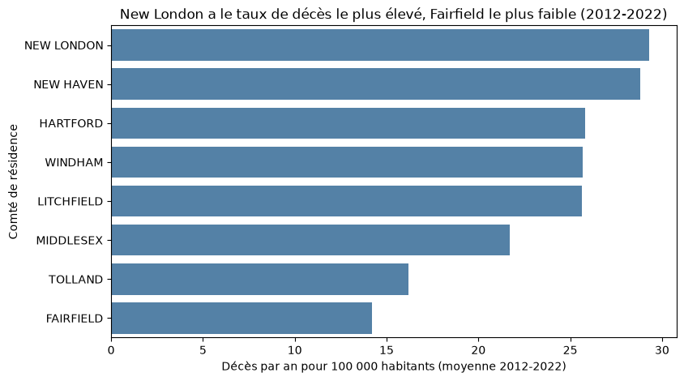

# Décès accidentels liés aux drogues dans le Connecticut (2012-2022)

Mini-projet d'analyse de données réalisé dans le cadre du Bachelor Data/IA (HETIC).

## Question étudiée

Que nous apprennent les décès accidentels liés aux drogues enregistrés dans le Connecticut entre 2012 et 2022 ? L'analyse répond à cinq questions :

1. Parmi les 5 substances les plus souvent détectées, quelle part des décès implique chacune, et comment cette part a-t-elle évolué de 2012 à 2022 ?
2. Quelles associations de substances reviennent le plus souvent parmi les décès ?
3. Quel est le profil (âge, sexe) des personnes décédées, et a-t-il changé entre 2012 et 2022 ?
4. Quels comtés comptent le plus de décès, en nombre et rapporté à leur population ?
5. Les décès surviennent-ils majoritairement au domicile ou à l'hôpital ?

Une analyse mensuelle (étape 07) complète ces questions.

## Sources des données

- **Jeu de données principal** : *Accidental Drug Related Deaths 2012-2022*, publié sur Kaggle : https://www.kaggle.com/datasets/usmanlovescode/accidental-drug-related-deaths-2012-2022
  - Fichier : `Accidental_Drug_Related_Deaths_2012-2022.csv` (10 654 lignes, 48 colonnes)
  - Date de téléchargement : [09/10/2026]
  - Licence : CC0: Public Domain
- **Population des comtés** (utilisée pour la jointure de la Q4) : U.S. Census Bureau, recensement 2020, population par comté du Connecticut. Les 8 valeurs sont saisies à la main dans `03_analyse.ipynb` ; leur somme est contrôlée (3 605 944 habitants).

Le jeu de données décrit des décès réels. L'analyse reste agrégée et ne cherche à identifier aucune personne.

## Structure du dépôt

```
projet-analyse/
├── data/raw/          CSV d'origine (jamais modifié)
├── data/processed/    deces_nettoyes.csv, produit par 02_nettoyage.ipynb
├── notebooks/         01_exploration, 02_nettoyage, 03_analyse
├── src/               nettoyage.py (conversion des colonnes de substances en booléens)
├── figures/           graphiques produits par les notebooks
├── requirements.txt   versions figées des bibliothèques
└── README.md
```

## Installation

Depuis le dossier du projet :

```bash
python3 -m venv .venv
source .venv/bin/activate          # Windows : .venv\Scripts\activate
pip install -r requirements.txt
```

## Accès aux données

Télécharger le CSV depuis la page Kaggle ci-dessus et le placer, sans le renommer, dans `data/raw/` :

```
data/raw/Accidental_Drug_Related_Deaths_2012-2022.csv
```

Le fichier nettoyé `data/processed/deces_nettoyes.csv` est recréé automatiquement par `02_nettoyage.ipynb`.

## Ordre d'exécution

Exécuter les notebooks dans l'ordre, avec « Restart and Run All » :

1. `notebooks/01_exploration.ipynb` : chargement et inspection du CSV brut
2. `notebooks/02_nettoyage.ipynb` : nettoyage documenté (chaque décision est expliquée et chiffrée), export du fichier nettoyé
3. `notebooks/03_analyse.ipynb` : réponses aux 5 questions, jointure, analyse temporelle et conclusions

## Principaux résultats

Le nombre de décès a été multiplié par 4 en 11 ans : 354 en 2012, 1 524 en 2021 (maximum), 1 452 en 2022.

**Le fentanyl a remplacé l'héroïne.** Le fentanyl est détecté dans 4,0 % des décès en 2012 et dans 86,3 % en 2022. L'héroïne culmine en 2014 (58,2 %) puis tombe à 8,6 %. Les deux courbes se croisent en 2017.



**Le profil d'âge a vieilli.** 72,7 % des personnes décédées avaient entre 30 et 59 ans et environ 3 sur 4 étaient des hommes. La part des 55 ans et plus passe de 13,2 % à 31,6 % entre 2012 et 2022, et l'âge médian de 41 à 47 ans.



**Les comtés les plus touchés ne sont pas les plus peuplés.** En nombre, New Haven, Hartford et Fairfield comptent le plus de décès. Rapporté à la population, New London (29,3 décès par an pour 100 000 habitants) et New Haven (28,8) ont les taux les plus élevés, Fairfield le plus faible (14,2).



**Le domicile reste le premier lieu de décès** (52,8 %), devant l'hôpital (28,8 %), dont la part recule de 37,6 % à 23,7 % entre 2012 et 2022.

**Associations de substances** : la plupart des substances du top 5 sont détectées ensemble à une fréquence proche de leur moyenne. L'écart le plus net est négatif (cocaïne et benzodiazépines, −12,2 points).

**Rythme mensuel (étape 07)** : [à compléter après l'étape 07].

## Limites

- **Un seul État** : les résultats concernent le Connecticut et ne se généralisent pas aux États-Unis.
- **Données administratives déclarées** : elles dépendent des pratiques d'enregistrement, qui ont pu changer (nouveau formulaire pour le lieu du décès en 2021). En 2015 et 2017, les dates sont des dates de déclaration, pas de décès.
- **Plusieurs substances par décès** : on compte des détections, pas des causes.
- **Uniquement des décès** : le jeu ne permet pas de mesurer la consommation ni un risque par âge, sexe ou substance. Seuls les taux par comté sont rapportés à une population (recensement 2020, utilisé pour toute la période).
- **Données manquantes** : 1 163 décès sans comté de résidence sont exclus de la Q4, donc les taux par comté sont des minimums.
- **Description, pas explication** : l'analyse décrit des évolutions sans en identifier les causes.